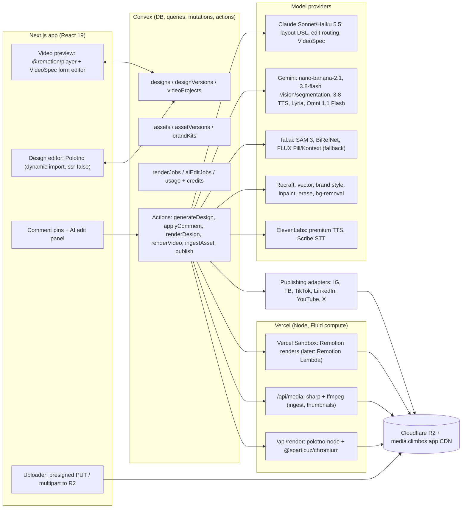

# Design and video system for ClimbOS social content

Researched 17 Oct 2026. This covers AI-made image posts and short videos, the in-browser editor customers use afterwards, point-and-comment AI editing, customer uploads, rendering, storage and publishing specs.

**Who it's for:** whoever builds the ClimbOS content engine. Read it alongside [`anthropic-platform.md`](./anthropic-platform.md) (Claude model IDs, prices, structured-output limits) and [`channel-content.md`](./channel-content.md) (copy rules and per-channel playbooks). This document covers the visual side only.

**Source discipline:** prices and limits come from vendor pricing pages, docs or npm tarballs fetched today unless marked otherwise. **UNVERIFIED** means I could not confirm the point from a primary source. When two official pages disagree, both values are given. Package versions were checked with `npm view` today.

**Repo context:** the stack is Next.js 16.4.2, React 19.3.0, Convex 1.47, `@google/genai` 2.30.0, and R2 through `aws4fetch` (`convex/lib/r2.ts`). `artifactVersions` holds one flat `imageR2Key`, and `shared/ai/models.ts` still routes premium images to `gemini-3.1-flash-image`, which Google deprecated on 6 Oct 2026 (see D1).

---

## 0. Decisions at a glance

| Question | Recommendation | Main reason | Confidence |
|---|---|---|---|
| Editor | **Polotno SDK 4.x** (React 19 line), embedded in a Next.js client component | Canva-like out of the box. Its open JSON design format has a published zod/JSON Schema package. `polotno-node` renders exactly what the editor shows. It has built-in mask-brush hooks for "replace/remove object". | High on fit. **The licence price is quote-only, and one clause needs written sign-off.** |
| Canonical document | The Polotno design JSON, with ClimbOS semantics (roles, brand tokens, provenance, locks) in each element's `custom` field. The AI reads a compact **projection** and writes **typed ops**, never raw Polotno JSON. | Keeps the AI interface small and schema-valid. Limits lock-in: the projection and op layer work with any editor engine. | High |
| Still rendering | `polotno-node` (headless Chromium) in a **Vercel Function** (Fluid compute, Node), called from a Convex action. Satori only for OG and thumbnail cards. | Same engine as the editor means pixel parity. Convex Node actions have 512 MiB RAM, too little for Chromium. | Medium-high. Needs a spike to confirm cold-start and bundle size. |
| Video composition | **Remotion 4** templates, previewed with `@remotion/player`. ClimbOS builds a simple scene/props editor, not a full timeline. | React-native, deterministic, and the video spec is plain props JSON that an LLM can write. | High |
| Video rendering | Start on **Vercel Sandbox** via `@remotion/vercel` (experimental). Move to **Remotion Lambda** when volume or speed demands it. | No AWS account on day one. Lambda is faster and cheaper per render at scale. | Medium |
| Generative video | **Gemini Omni 1.1 Flash** (`gemini-omni-1.1-flash`, about $0.10/s at 720p) as a paid add-on for AI b-roll only. **Do not build on Veo 3.1 Gemini API previews:** they shut down **22 Oct 2026**. | Deprecation schedule. Cost. | High on the deprecation, medium on Omni quality |
| Image generation | `gemini-nano-banana-2.1` for backgrounds and scenes. Recraft V4.x for vector, icon and brand-style assets. **Never bake headline text into AI images**: text stays a live layer. | Price and quality. Editable text. | High |
| Region edits ("make this brighter", "replace the mug") | Click, then an LLM router chooses either **layer ops** or a **pixel edit**. Pixel edits run a SAM 3 point-prompt mask, then edit a crop (Nano Banana 2.1, or FLUX Fill / Recraft inpaint for strict masks), then **alpha-composite back with our own feathered mask**, so every pixel outside the mask stays byte-identical. | Gemini image models accept no mask parameter. Compositing ourselves guarantees untouched pixels. | High |
| Layout generation | **Hybrid**: a library of parametric layout archetypes. Claude picks one, fills the slots and tunes it within bounds. A deterministic linter plus a vision critic score 2–3 variants. | Template systems are reliable but samey, and free-form LLM layouts break. Every leading tool mixes the two. | High |
| Cost per post (est.) | Single image post **~$0.08–0.15**. 7-slide carousel **~$0.25–0.40**. Point-and-comment edit **~$0.01 (layer)** to **~$0.05–0.08 (pixel)**. 30 s template video **~$0.20–0.35**. With 2 AI clips **~$1.9–2.6**. | See H5 | Medium |

**Blockers to clear first:** (1) a Polotno quote, plus written confirmation that ClimbOS's use is allowed under the "no competing editor or design platform" clause; (2) Remotion licence eligibility (headcount); (3) the existing Meta/TikTok/LinkedIn app reviews, since publishing APIs need approved apps; (4) moving off `gemini-3.1-flash-image` and away from any Veo preview IDs.

---

## A. Editor technology

### A1. What we need from the editor

The feature list from the brief: move, resize and rotate layers; edit text, fonts and colours; swap images; crop; remove backgrounds; snap to alignment guides; undo and redo; multi-page carousels; export PNG/JPG/PDF (and MP4 later). It also has to host the point-and-comment overlay, enforce brand locks, and accept AI patches without fighting the user's own edits.

### A2. Candidates

Versions checked on npm today. "Agent-friendliness" means how easily Claude can generate and patch the document.

| Option | Version / licence | What it is | Multi-page | Text editing | Export | Video | Agent-friendliness | Cost at small-SaaS scale |
|---|---|---|---|---|---|---|---|---|
| **Polotno SDK** | `polotno` 4.16.1, proprietary ([LICENSE.md in the npm tarball](https://www.npmjs.com/package/polotno)); peer deps `react ^19.3.0`, Blueprint 6 | Complete Canva-style editor (side panels, toolbar, pages timeline) on Konva + MobX | Yes | Good: rich text, curved text, auto-fit (`textOverflow: 'fit'`, `minFontSize`, `maxLines`) | PNG, JPEG, PDF, SVG, GIF, MP4, PPTX, HTML, JSON ([AI info page, Apr 2026](https://polotno.com/ai-info-page)) | Video and audio elements, animations, MP4 export | **Excellent.** Open JSON with `@polotno/schema` 0.9.0 (zod, JSON Schema, `validateDesign`, `normalizeDesign`, schema migrations). `custom` field on every element. | Quote-only, "from low hundreds" to $20–30k+ enterprise ([pricing](https://polotno.com/sdk/pricing)). Third parties cite $249/mo "Grass Roots" (manual review) and $899/mo self-serve ([Orshot](https://orshot.com/blog/polotno-studio-alternative), [Capterra](https://www.capterra.com/p/10022345/Polotno/)). **UNVERIFIED** |
| **IMG.LY CE.SDK** | `@cesdk/cesdk-js` 1.84.0, proprietary; 143 MB unpacked (WASM engine plus assets) | Full creative editor (design and video modes), Node renderer `@cesdk/node` | Yes | Very good | PNG/JPEG/PDF/MP4 | Strong, with a web video mode | Medium. The scene API is imperative (block API), and saved scenes are an engine string or archive, not a documented open JSON (**UNVERIFIED**) | Quote-only, per platform and component ([pricing](https://img.ly/pricing.md)). Vendr's median is about $17.5k/yr for an older product line ([Vendr](https://www.vendr.com/marketplace/img-ly)). |
| **Fabric.js** | `fabric` 7.4.0, MIT | Canvas object model library | DIY | Built-in IText editing, reasonable | PNG/JPEG/SVG (DIY PDF) | None | Medium. `toJSON` works, but the schema is ours to design | Free, but 3–6 engineer-months to reach Polotno parity (my estimate). Note the 7.2 fix for SVG-export XSS ([CVE-2026-27013](https://nvd.nist.gov/vuln/detail/CVE-2026-27013)). |
| **Konva / react-konva** | `konva` 10.9.0, `react-konva` 19.3.2, MIT | Canvas scene graph with React bindings (Polotno is built on it) | DIY | Weak: needs a textarea overlay | PNG/JPEG (DIY PDF) | DIY | Good, since it's our own schema | Free, with the most build effort |
| **tldraw SDK** | `tldraw` 5.5.2, custom licence | Infinite whiteboard | Pages | Whiteboard-grade | PNG/SVG | No | Good (store JSON, rich AI hooks) | Production needs a key: commercial is quote-only, hobby is watermarked, 100-day trial ([licence key docs](https://tldraw.dev/sdk-features/license-key), [pricing](https://tldraw.dev/pricing)). Wrong paradigm for fixed-size social canvases. |
| **Excalidraw** | `@excalidraw/excalidraw` 0.18.1, MIT | Hand-drawn whiteboard | No | Basic | PNG/SVG | No | OK | Free. Wrong aesthetic and paradigm. |
| **Pintura** | `@pqina/pintura` 8.100.4, commercial | Single-image editor (crop, filters, annotate) | No | Annotation text only | Image | Trim and clip via extension | Low (not a layout tool) | €749/yr per developer seat, €1,149 with video; Personal €169/yr ([pricing](https://pqina.nl/pintura/pricing/)). Fine as a photo-cropping modal; not a design editor. |
| **Filerobot Image Editor** | `react-filerobot-image-editor` 5.0.0-beta.159, MIT | Single-image editor | No | Annotation | Image | No | Low | Free, but v5 is still in beta after a long time |
| **Pixie** | CodeCanyon item (Vebto) | Standalone image editor app | No | Basic | Image | No | Low | Envato Extended Licence needed when end users pay ([vendor comments](https://codecanyon.net/item/pixie-image-editor/10721475/support)). Not React-native. |
| **Build on SVG/HTML** | n/a | DOM or SVG editor | DIY | Native browser text, best accessibility | Needs headless Chromium for raster | DIY | Excellent | Free, with the largest effort |

**Bundle size.** The standalone `polotno.bundle.js` is 2.76 MB minified, about 830 KB gzipped (measured from the tarball). The modular ESM build used with Next.js should tree-shake somewhat. Load the editor with `next/dynamic` and `ssr: false` so it never touches marketing pages. For comparison, Fabric's `index.min.js` is about 90 KB gzipped and Konva's about 57 KB, but those are only engines. CE.SDK's WASM and assets are far heavier.

**Accessibility.** Every canvas editor here draws content to `<canvas>`, so screen readers can't see the design itself. Mitigations: Polotno's panels use Blueprint components, which are keyboard-operable. ClimbOS should add an accessible **layers list** (a tree of named layers with role and text) and keyboard nudging. Generated alt text should be sent with publishes (Instagram's API accepts `alt_text` on image posts but not on Reels or Stories, per the [publishing docs](https://developers.facebook.com/docs/instagram-platform/content-publishing)). The SVG/HTML route would be the most accessible, but it costs months.

### A3. Why Polotno is the most agent-friendly option

Things verified in the 4.16.1 and `@polotno/schema` 0.9.0 tarballs:

- **Document shape.** `Design { schemaVersion (4), width, height, unit, dpi, fonts[], pages[], audios[], custom }`. `Page { id, width|'auto', height|'auto', background, duration, children[] }`. Elements are a union of `text | image | svg | line | figure | video | gif | group | table`. Every element has `x, y, width, height, rotation, opacity, blendMode, filters, shadow*, animations[]`, the lock flags `draggable / resizable / selectable / removable / contentEditable / styleEditable`, and **`custom`** for arbitrary metadata. Image-like elements carry normalised crop (`cropX/Y/Width/Height` in 0–1) and `clipSrc` masks.
- **Validation tooling.** `@polotno/schema` exports `validateDesign(json, {mode:'partial'|'canonical'})`, `normalizeDesign()` (fills defaults and migrates old `schemaVersion`s) and `design.schema.json`, so AI output can be validated server-side without loading the editor.
- **Pluggable AI image tools.** `polotno/config` exports `setReplaceObjectFunc`, `setRemoveObjectFunc`, `setExpandFunc`, `setUpscaleFunc` and `setRemoveBackgroundFunc`. Replace and remove handlers receive `{ image: Blob, size, mask: Blob, region: Rect, prompt }`. That means Polotno's own brush/mask UI can route straight to ClimbOS's region-edit backend (section D4) with almost no custom canvas work.
- **Brand locks** map to the element flags. For example, a logo is `removable:false, styleEditable:false`, and a "brand footer" group is `selectable:false`.

**Licence terms to resolve before signing:**

- The npm `LICENSE.md` allows **60 days** of evaluation. Polotno's legal page and AI info page say **30 days** ([licence](https://polotno.com/legal/license), [AI info](https://polotno.com/ai-info-page)). Production use, including internal tools, needs a subscription.
- One subscription covers **one commercial application under one brand family**. ClimbOS fits that.
- The licence bars using the SDK to build or help build a **"competing editor, SDK, or design platform"**. ClimbOS embeds a Canva-like editor for SMB marketing. That is not a general design platform, but **get written confirmation**.
- If payment lapses, all use must stop immediately. Keep the abstraction in A5 so there is an exit path.
- Built-in Unsplash and other stock panels go through Polotno's API with Polotno's keys. For guaranteed limits, supply our own keys.

### A4. Recommendation

**Use Polotno SDK 4.x**, conditional on a quote in the "low hundreds per month" range and the clause confirmation. Rationale:

1. It covers about 90% of the feature list on day one: transforms, snapping, crop, multi-page, fonts, undo/redo via `store.history`, background removal hook, PDF/PNG/MP4 export.
2. The document is open, schema-validated JSON with migrations, which is the best basis for AI generation and patching of any option.
3. `polotno-node` 3.13.0 renders the same JSON server-side with headless Chromium to PNG, JPEG, PDF and MP4, so the editor and published output match.
4. The mask-tool hooks match feature (4) exactly.
5. It is actively maintained: 4.16.1 and polotno-node 3.13.0 were both published 15 Oct 2026.

**Fallback if Polotno's terms fail:** react-konva plus our own schema (the A5 projection becomes the canonical document), with `polotno-node` replaced by Konva on `@napi-rs/canvas` (1.0.11, MIT) or Chromium. Budget roughly a quarter of front-end work. **Do not choose IMG.LY** at this stage: it is quote-only at enterprise price points, the package is about 143 MB, and the scene format is less transparent to an LLM. Reconsider it only if in-browser video timeline editing becomes the core product.

### A5. The AI-facing layer (projection plus ops)

Don't let Claude emit raw Polotno JSON. It is large (the JSON Schema is 103 KB), mostly defaults, and Claude's strict structured outputs reject recursion and limit a request to 24 optional params and 16 union-typed params ([anthropic-platform.md §3.3](./anthropic-platform.md)). Instead:

- **Projection** (read side): a compact, engine-agnostic view per page. It has layer `id`, `role`, `type`, a rounded `box`, `z`, text with style tokens, an asset ref, lock state and a short `desc`. About 50–150 tokens per layer.
- **Ops** (write side): a closed discriminated union of 12 or fewer op types, validated and applied by deterministic code. The design itself is never regenerated wholesale.
- **Compiler**: turns ClimbOS's layout DSL (section E3) into Polotno JSON at creation time.

That isolates the vendor. Swapping engines means rewriting the compiler and applier, not the prompts.

---

## B. Rendering and export pipeline

### B1. Options

| Renderer | How | Parity with the Polotno editor | Fonts | Where it can run | Notes |
|---|---|---|---|---|---|
| **polotno-node** 3.13.0 | Puppeteer 25 + `@sparticuz/chromium` 153 loads the Polotno client and calls `store.toDataURL`, `toPDF` or video export | **Exact** (same code) | Loads `fonts[]` URLs. Google Fonts responses are cached in memory and on disk (`useFontCache`, default on). | Vercel Function (Node, Fluid compute), Vercel Sandbox, any container. **Not** Convex. | Has `jsonToImageBase64`, `jsonToPDFBase64`, `jsonToVideoFile`, `pixelRatio`, `assetLoadTimeout` (default 30 s). For video it downloads remote media, probes with ffprobe and normalises to H.264/yuv420p/AAC ([README in tarball](https://www.npmjs.com/package/polotno-node)). |
| Polotno Cloud Render API | Hosted REST, same JSON | Exact | Same | Polotno's US cloud | Outputs deleted after 7 days. Pricing not published ([AI info](https://polotno.com/ai-info-page)). Useful as overflow capacity. |
| **Satori 0.62 + resvg-js 2.6.2** | JSX → SVG → PNG (MPL-2.0) | **None**: a separate layout engine | TTF, OTF, WOFF and WOFF2 passed as buffers | Anywhere, including edge | Satori now uses Taffy (Flexbox, Grid, block) and supports masks, filters and blend modes ([README](https://www.npmjs.com/package/satori)). It is still not full CSS, and text metrics differ from Konva. Use it for OG cards, thumbnails and email previews only. |
| `@napi-rs/canvas` 1.0.11 | Skia bindings; Konva can run on it | Close if we own the renderer | Register TTF/OTF | Vercel, Convex Node (small images) | Only relevant on the react-konva fallback path. |
| Puppeteer + our own HTML | Chromium screenshots of HTML/SVG | Exact for an HTML editor | Web fonts | Vercel Function or worker | Only on the "build on SVG/HTML" path. |

### B2. Where to run it

- **Convex.** Node actions get 10 minutes and **512 MiB RAM**. The deployment code size limit is 90 MB compressed and 230 MB uncompressed, and Node action arguments are capped at 5 MiB ([Convex limits](https://docs.convex.dev/production/state/limits)). Chromium will not fit comfortably. Use Convex to orchestrate: create the job, call the renderer over HTTPS, store the R2 key, update status.
- **Vercel Functions.** Hobby defaults to 300 s, while Pro and Enterprise default to 300 s and can be configured up to 800 s. With Fluid compute, extended durations reach 1,800 s (Pro/Ent, changelog Aug 2026). Bundles are normally capped at 250 MB, and Node/Python functions can now reach **5 GB** on Fluid compute: public beta, new projects enrolled automatically, older projects opt in with `VERCEL_SUPPORT_LARGE_FUNCTIONS=1` ([limits](https://vercel.com/docs/functions/limitations), [5 GB changelog](https://vercel.com/changelog/vercel-functions-can-now-be-up-to-5-gb-in-package-size)). Memory is 2 GB on Hobby and up to 4 GB on Pro. Pricing is $0.128 per Active-CPU-hour plus $0.0106 per GB-hour of provisioned memory in iad1 ([Fluid pricing](https://vercel.com/docs/fluid-compute/pricing)). A 5 s, 2 GB still render costs well under $0.001.
- **Recommendation.** Create one dedicated route, `app/api/render/route.ts` (`runtime = 'nodejs'`, `maxDuration = 120`, 2–3 GB memory). It holds a warm `polotno-node` instance, accepts `{designVersionId, pageIds, format, scale}` with an HMAC-signed body from Convex, reads the JSON and assets via signed R2 URLs, writes outputs to R2, and returns keys. Keep `useParallelPages` on for carousels. In next.config, keep `@sparticuz/chromium` and `polotno-node` in `serverExternalPackages` (check the Next 16 docs in `node_modules/next/dist/docs/` per AGENTS.md). Fall back to the Polotno Cloud Render API if cold starts hurt.
- **Video MP4 from Polotno** (animated stills) can also run there for clips under about 20 s. Longer jobs belong in Vercel Sandbox (section C2).

### B3. Fonts

- Store every brand font as WOFF2 for the editor and TTF for any Satori path, in R2 behind a CDN custom domain. Reference them in `design.fonts[]` by URL so editor and renderer load identical files.
- Google Fonts (OFL) are safe to embed and render server-side.
- Customer-uploaded fonts carry licence risk: desktop licences often forbid web embedding or server rendering. Require an upload attestation ("I have a licence that permits web and app embedding") and store it on the asset.
- **Warm the font cache** per instance. polotno-node's README warns that parallel renders can get throttled by Google Fonts and silently fall back to a default font. **Self-host all fonts** to remove that failure mode.
- After every render, check that the requested families actually loaded (e.g. `document.fonts.check` inside the page). Fail the job instead of publishing a fallback-font image.

### B4. Quality settings

| Output | Canvas | Export | Notes |
|---|---|---|---|
| IG/FB feed portrait | 1080×1350 | JPEG q≈90, sRGB, `pixelRatio: 1` | IG's API accepts JPEG only, ≤8 MB, width 320–1440 ([IG media ref](https://developers.facebook.com/docs/instagram-platform/instagram-graph-api/reference/ig-user/media)). Optionally export 1440×1800 for crispness. IG downsizes anyway. |
| Stories / Reels cover / TikTok photo | 1080×1920 | JPEG q≈90 | TikTok photos max out at 1080p, ≤20 MB, JPEG/WebP ([TikTok media transfer](https://developers.tiktok.com/doc/content-posting-api-media-transfer-guide)) |
| LinkedIn document carousel | 1080×1350 or 1080×1080 pages | **Vector PDF** via `jsonToPDFBase64` | ≤100 MB, ≤300 pages ([Documents API](https://learn.microsoft.com/en-us/linkedin/marketing/community-management/shares/documents-api)) |
| Editor preview / thumbnails | Any | PNG at `pixelRatio: 0.25–0.5` | polotno-node notes that low ratios are for previews only |

Render AI-generated raster layers at 2K (Nano Banana 2.1 2K is $0.0504) when they fill more than half the canvas. Use 1K for small inset images.

---

## C. Video

### C1. Composition engine

| Option | Status / licence | Fit |
|---|---|---|
| **Remotion** 4.0.536 (`remotion`, `@remotion/player`, `@remotion/lambda`, `@remotion/cloudrun`, `@remotion/vercel`) | Source-available. **Free for individuals and companies of up to 3 people.** Companies of 4+ need a Company Licence: *Automators* $0.01 per render with a **$100/mo minimum**, *Creators* $25/seat/mo, Enterprise from $500/mo ([licence](https://www.remotion.pro/license)). A "render" is a successful video, still, GIF, audio or PDF. Player and Studio previews don't count. A free-tier company **may** launch a SaaS, but end users can't submit their own Remotion code ([FAQ](https://www.remotion.dev/docs/license/faq)). Contractors operating the project count toward headcount. Server-side telemetry becomes mandatory for Automators in Remotion 5. | **Best fit.** Templates are React components, the video spec is a props JSON Claude can write, captions have first-party helpers (`@remotion/captions`), and `@remotion/player` gives an in-browser preview. **Editor Starter** (a timeline editor boilerplate) is $600 one-time or included with Enterprise ([buy](https://www.remotion.dev/docs/editor-starter/buy)). |
| Polotno video | Included in the Polotno licence | Fine for animated stills (enter/exit animations, a background video, a music bed). Weaker for word-synced captions and multi-scene pacing. Use it for "animated post" variants only. |
| Revideo (`@revideo/core` 0.11.0, MIT) | Motion Canvas fork. Last npm publish Jul 2026. | Capable, but momentum is unclear ([Best of JS](https://bestofjs.org/projects/revideo)). |
| Motion Canvas (`@motion-canvas/core` 3.17.2, MIT) | Last release Feb 2025. Reported unmaintained, with the site offline. Community fork "Canvas Commons" exists ([slama.dev](https://slama.dev/motion-canvas/1/)). | Avoid. |
| **Shotstack** (JSON → video API) | $39/mo for 250 min at 1080p, up to $499/mo for 10,000 min (5¢/min) ([pricing](https://shotstack.io/pricing/)) | Good fallback if we don't want to run renderers. Templates live in their JSON, not React. |
| **Creatomate** | Credit-based. About 14 credits per minute at 720p/25 fps. Preview SDK from the Growth plan. Prices not in page text ([pricing](https://creatomate.com/pricing)). | Similar to Shotstack. Its embeddable preview SDK is the attraction. |
| **JSON2Video** | 1 credit per second at 1080p (4× for 4K), $49.95/mo for 200 min. Free tier watermarked ([pricing](https://json2video.com/pricing/)). | Cheapest per minute at low volume. Least control. |
| Raw ffmpeg pipeline | LGPL/GPL builds | Use it for **ingest** (transcode, probe, thumbnails, loudness normalisation), not for composition. Text animation in ffmpeg filters is painful. |

**Licence action:** count the ClimbOS operating entity's headcount, including contractors who touch the Remotion project. If it is 3 people or fewer, Remotion is free today. Budget for Automators ($100/mo minimum, covering 10,000 renders) from the day it becomes 4.

### C2. Rendering infrastructure

| Option | Cost | Speed | Notes |
|---|---|---|---|
| **Vercel Sandbox** via `@remotion/vercel` (experimental) | Active CPU $0.128/vCPU-h. Memory about $0.0212/GB-h (Vercel's pages show three different memory rates). Pro sandboxes up to 8 vCPU / 16 GB and 5 h ([Sandbox pricing](https://vercel.com/docs/vercel-sandbox/pricing)). | Single machine, a few seconds of boot ([Remotion docs](https://www.remotion.dev/docs/vercel-sandbox.md)) | No AWS account. Output goes to Vercel Blob by default, so copy it to R2. Add our own rate limiting and clean up snapshots. A 30 s 1080×1920 render on 4 vCPU is estimated at 1–2 min, about $0.01–0.03 (**UNVERIFIED**, measure in the spike). |
| **Remotion Lambda** | Remotion's examples (2 GB, us-east-1): 1-min embedded-video render about $0.017–0.021, 10-s 4K about $0.013 ([cost example](https://www.remotion.dev/docs/lambda/cost-example)) | Parallel chunks, typically tens of seconds | Needs AWS. The best choice at volume. |
| Remotion Cloud Run | GCP pricing | Single container | Viable if we open a GCP project for Veo on Vertex anyway. |
| Shotstack/Creatomate | Per-minute fees above | Fast | Zero ops, more lock-in. |

### C3. AI video generation

**Google:**

- The Gemini API **Veo 3.1** preview models (`veo-3.1-generate-preview`, `-fast-`, `-lite-`) have a published shutdown date of **22 Oct 2026**, with `gemini-omni-1.1-flash` as the replacement ([deprecations](https://ai.google.dev/gemini-api/docs/deprecations)). Until then: 4, 6 or 8 s; 16:9 or 9:16; 720p, 1080p or 4K (8 s only); native audio; 24 fps; first/last frame; up to 3 reference images; outputs kept 2 days; latency 11 s to 6 min ([Veo docs](https://ai.google.dev/gemini-api/docs/veo)). Prices: Standard $0.40/s, Fast $0.10–0.12/s, Lite $0.05–0.08/s ([pricing](https://ai.google.dev/gemini-api/docs/pricing)). GA Veo stays on Google Cloud's enterprise platform. Third-party sources put it at about $0.20–0.40/s ([WaveSpeed](https://wavespeed.ai/blog/cost-and-billing/google-veo-3-pricing/)); **UNVERIFIED**.
- **Gemini Omni 1.1 Flash** (`gemini-omni-1.1-flash`, Interactions API):
  - Formats: 9:16 or 16:9; 360p, 720p (default), or 1080p/4K upscaled. Audio is generated from the prompt, including music and SFX.
  - Inputs: image-to-video with first/last frame and multi-image subject reference. Video references are limited to 3 clips of up to 3 s each.
  - Editing and extension: it edits uploaded videos of 10 s or less, but **not for users in the EEA, Switzerland or the UK**. Extension adds 3–10 s per turn, up to 40 s total. SynthID is on every output ([Omni docs](https://ai.google.dev/gemini-api/docs/omni)).
  - Clip length: launch coverage says up to 10 s ([IT Brief](https://itbrief.co.uk/story/google-launches-gemini-omni-flash-for-video-editing)).
  - Price: $17.50 per 1M output video tokens at 5,792 tokens per second of 720p, **about $0.101/s**. No 1080p rate is published (**UNVERIFIED**).

**Others (brief; mostly aggregator prices, UNVERIFIED):**

| Model | Approx. API price | Note |
|---|---|---|
| Kling 3 (Pro/Std) | $0.14/s on fal.ai ([fal pricing](https://fal.ai/pricing)). Third parties say $0.084–0.168/s direct. | Strong motion quality. Chinese vendor, so consider data-residency questions. |
| Runway Gen-4.5 | About $0.12/s ([apiframe](https://apiframe.ai/blog/ai-video-api-pricing-2026)) | Good for stylised b-roll |
| Luma Ray3 | No clear per-second API price found | |
| Pika 2.5 | Consumer-focused | Skip |
| Sora 2 | About $0.10/s for 720p (Pro is higher). One source says OpenAI is removing the API on 24 Sep 2026 (**UNVERIFIED**). | Excluded by the no-OpenAI rule anyway |

**Policy for small businesses.** Generated clips must never *depict the customer's actual product, premises, staff or results*. That is misrepresentation, and it conflicts with the fact-grounding rule in `channel-content.md`. Use AI clips for scene-setting b-roll (steam over coffee, a city morning) or to animate a real customer photo (image-to-video), and label them as AI internally. Prefer customer footage whenever any exists.

### C4. Voiceover, captions and music

**TTS:**

| Option | Price | Notes |
|---|---|---|
| `gemini-3.8-flash-tts` | $0.50/M input, $9/M audio output through 31 Dec 2026, then roughly double ([pricing](https://ai.google.dev/gemini-api/docs/pricing)) | 30 prebuilt voices plus an extended library, voice design and replication (200 stored voices per project), 130+ languages, 2-speaker dialogue, inline vocal tags, 24 kHz WAV/PCM ([speech docs](https://ai.google.dev/gemini-api/docs/speech-generation)). **No word timestamps.** A 30 s voiceover is about 1k audio tokens, roughly $0.01 (token rate per second is **UNVERIFIED**). |
| `gemini-3.8-flash-lite-tts` | $6/M audio output | Cheaper. 100+ languages. |
| Older Gemini TTS IDs | | `gemini-2.5-*-preview-tts` and `gemini-3.1-flash-tts-preview` shut down **17 Nov 2026**, so don't use them |
| ElevenLabs Flash / v4 Turbo | $0.04 per 1k characters | Premium voices. A 30 s script (about 450 characters) costs about $0.018. |
| ElevenLabs v4 / Multilingual v2 | $0.08 per 1k characters ([API pricing](https://elevenlabs.io/pricing/api)) | |

ElevenLabs' `/with-timestamps` TTS endpoint returns alignment data (character-level per a third-party gateway doc, **UNVERIFIED**).

**Captions (word timing):**

- When we generate the voice, we already know the script, so we only need *alignment*. Run STT with word timestamps on the generated audio, then align the recognised words to the script so spelling and brand names come out exactly right.
- ElevenLabs **Scribe v2** costs $0.22/h and lists word-level timestamps ([STT docs](https://elevenlabs.io/docs/overview/capabilities/speech-to-text.md)). A 30 s clip costs about $0.002. The pricing table attaches "word timestamps" to the realtime model, so confirm against the batch API.
- Google's Gemini 3.5 Transcribe (Cloud) offers word timestamps only as experimental, and turning them on lowers accuracy ([Google Cloud docs](https://docs.cloud.google.com/gemini-enterprise-agent-platform/models/gemini/3-5-transcribe)).
- The self-hosted option is whisper.cpp via `@remotion/install-whisper-cpp` in the render worker.
- Customer-uploaded talking-head videos follow the same path.

**Music:**

| Source | Price | Licensing |
|---|---|---|
| **Lyria** via Gemini API: `lyria-3-clip-preview` (30 s), `lyria-3.5` and `lyria-3-pro-preview` (full song) | $0.04 per clip, $0.08 per song. Paid tier only. ([pricing](https://ai.google.dev/gemini-api/docs/pricing)) | The pricing page has no output-licensing language, so check the Gemini API terms for generated-content ownership (**UNVERIFIED**) |
| ElevenLabs Music | $0.15/min | Commercial use on Starter plans and above |
| **Epidemic Sound Partner API** | Free tier is prototype-only and can't go live. *Scale* has custom pricing, a commercial licence, sub-licensing for end users, and safelisting as an add-on ([developers](https://developers.epidemicsound.com/)). | Best catalogue choice. Safelisting matters for YouTube Content ID: a Short over 1 minute with any Content ID claim is blocked globally ([YouTube help](https://support.google.com/youtube/answer/15424877)). |

Platform-native trending sounds can't be attached through any publishing API. Tell users to add trending audio in-app after publishing if they want it.

### C5. Recommended pipeline (15–45 s vertical video)

1. **Brief → VideoSpec.** Claude Sonnet 5.5 (structured output) writes a `VideoSpec`: template ID, hook (≤3 s), 3–6 scenes each with on-screen text (≤7 words), voiceover line, media slot (customer asset ID, stock, AI-image or AI-clip request), duration, CTA end card, caption style and music mood. It follows the per-channel rules in `channel-content.md`.
2. **Media resolution.** Customer assets first (asset-library search, F4). Then Nano Banana 2.1 stills animated by the template (Ken Burns, parallax, masks). Then, only on paid credits, `gemini-omni-1.1-flash` clips of 4–8 s at 720p, 9:16.
3. **Voice.** Gemini 3.8 Flash TTS (default) or ElevenLabs (premium voice). Scene durations come from the measured audio length.
4. **Captions.** STT with word timestamps on the VO, aligned to the script, as `@remotion/captions` JSON. Style: 2–4 words per caption page, highlighted active word, kept inside the safe zone (E4).
5. **Music.** Lyria clip or library track, ducked to about −18 dB under VO and normalised to around −14 LUFS integrated (common practice for social, **UNVERIFIED** per platform).
6. **Preview.** `@remotion/player` in the app. The user edits text, swaps media, changes voice or music, or reorders scenes in a ClimbOS form-and-list editor that edits the `VideoSpec`. No free timeline in v1.
7. **Render.** Remotion on Vercel Sandbox: H.264 High, yuv420p, 30 fps, 1080×1920, AAC 48 kHz 128 kbps, `moov` at the front (faststart), about 8–12 Mbps. That satisfies IG Reels (≤25 Mbps, 23–60 fps, ≤300 MB), TikTok, Shorts and LinkedIn at once (section G).
8. **QA.** A Gemini 3.8 Flash video-understanding check (safe-zone violations, caption overlap, black frames, audio present). ffprobe validation of the spec. A poster frame for the cover.

---

## D. AI image generation and editing

### D1. Gemini image models (Gemini API, Standard tier)

Sources: [pricing](https://ai.google.dev/gemini-api/docs/pricing), [deprecations](https://ai.google.dev/gemini-api/docs/deprecations), [image docs](https://ai.google.dev/gemini-api/docs/image-generation).

| Model ID | Name / status | Price per image | Capabilities that matter |
|---|---|---|---|
| **`gemini-nano-banana-2.1`** | Nano Banana 2.1. Released 6 Oct 2026, Google's "primary workhorse". | 1K $0.0336, 2K $0.0504, 4K $0.113 (Batch: half) | Up to 14 reference images (10 object refs). Multi-turn editing via `previous_interaction_id`. Search and image-search grounding. Thinking levels minimal/medium/high (**always on**, up to 2 free interim images). Text rendering suitable for menus and infographics. 1K/2K/4K, no 512px. SynthID on all outputs. |
| `gemini-3.1-flash-lite-image` | Nano Banana 2 Lite, GA 30 Jun 2026 | $0.0336 (1K only) | Fastest. **Not optimised for multi-reference or multi-turn editing.** No grounding. Ratios include 4:5 and 9:16. |
| `gemini-3.1-flash-image` | Nano Banana 2, **deprecated**, replacement is 2.1 | 1K $0.067, 2K $0.101 | **Currently used by `shared/ai/models.ts` premium route. Migrate.** |
| `gemini-3-pro-image` | Nano Banana Pro | 1K/2K $0.134, 4K $0.24 | Best brand consistency and complex composition. Use it sparingly for hero visuals. |
| `gemini-2.5-flash-image` | Legacy | $0.039 | The pricing page says shutdown 2 Oct 2026, while the deprecations page says 15 Mar 2027. Don't use it. |
| `imagen-4.0-*` | **Shut down 17 Aug 2026** on the Gemini API | | Gone |

**Implications:**

- Change the standard route to `gemini-nano-banana-2.1` at 1K. It costs the same as Lite and handles reference images and edits. Change the premium route to 2.1 at 2K ($0.0504, half the current $0.101). Keep Lite for cheap, no-reference generations.
- **No Gemini image model takes a mask parameter.** Edits are instruction-only, and Google documents no pixel-preservation guarantee. Vertex's mask-capable `imagen-3.0-capability-001` was reportedly scheduled for retirement on 30 Jun 2026 with no mask-capable successor ([Google dev forum](https://discuss.google.dev/t/imagen-3-0-capability-001-retiring-june-30-no-mask-based-editing-replacement-exists/343602), user report, **UNVERIFIED**). Hence the composite-back design in D4.
- **Product consistency:** never ask a model to redraw the customer's product. Cut out the real product photo (D3) and place it as its own layer over an AI-generated scene. Then ask Nano Banana 2.1 only for the background or shadow, or for a "harmonise lighting" pass on a flattened copy, which is optional and only kept if the critic approves.
- **Text in images:** Nano Banana's text rendering is good, but baked-in text can't be edited, translated or checked for contrast. Prompt every background with *"no text, no letters, no logos"*, and keep all copy as Polotno text layers.

### D2. Alternatives

| Provider / model | Price | Strength | Use in ClimbOS |
|---|---|---|---|
| **Recraft** V4.1 / V4 / V3 | V4.1 raster $0.035, vector $0.08. V4.1 Flash $0.007. V3 inpaint, outpaint and replace background $0.04. Erase region $0.002. Crisp upscale $0.004. Creative upscale $0.25. Background removal $0.01. Vectorise $0.01. Custom brand style $0.005 to create ([pricing](https://www.recraft.ai/docs/api-reference/pricing)). | True **SVG** output, brand styles, icons and illustrations, mask inpainting | Brand illustration packs, icons and patterns per brand kit. Cheap masked inpainting and erase. |
| **FLUX** (Black Forest Labs) | Kontext Pro $0.04/image on fal ([fal](https://fal.ai/models/fal-ai/flux-pro/kontext)). FLUX.1 Fill Pro (mask inpaint) about $0.05 (secondary sources). BFL now lists FLUX 3, FLUX.2 [pro/flex/max/klein], Outpainting and Eraser, but its page shows no per-model prices ([BFL pricing](https://bfl.ai/pricing)). | Instruction editing with good local fidelity (Kontext). True mask inpainting (Fill). | Secondary editor for pixel edits where Nano Banana drifts. |
| **Ideogram** 3.0 / 4.0 / 4.5 | API price table didn't load; $0.01 per credit, credit costs unknown ([pricing](https://ideogram.ai/pricing/?pricing_tab=api)). **UNVERIFIED** | Best-in-class text-in-image; mask edit | Only if we ever want baked typographic art (e.g. a stylised word-mark sticker). Low priority. |
| Stability (SD3.5 / inpaint) | Not checked | Mature inpainting | Not needed if the above work |
| GPT Image 2 (fal lists it) | | Strong text and editing | **Excluded by owner decision.** Note only. |

### D3. Background removal, segmentation and upscaling

| Need | Self-hosted / OSS | API | Recommendation |
|---|---|---|---|
| Background removal | **BiRefNet** (MIT; [repo/HF card](https://huggingface.co/zachyuan/BiRefNet/blob/main/README.md)) via fal (`fal-ai/birefnet/v2`; the page showed a $0 placeholder price) or our own GPU. `rembg` (MIT wrapper; model licences vary). **Avoid `@imgly/background-removal` in closed SaaS: it is AGPL-3.0** (checked in the 1.4.5 tarball). BRIA RMBG-2.0 is, to my knowledge, non-commercial (**UNVERIFIED**). | **Photoroom** Basic $0.02/image, Plus $0.10 (AI backgrounds, shadows, expand) ([pricing](https://www.photoroom.com/api/pricing)). Recraft $0.01. remove.bg is roughly $0.15–0.40/image by third-party reports ([costbench](https://costbench.com/software/ai-media-apis/remove-bg-api/)). | **Recraft ($0.01) or BiRefNet on fal as default. Photoroom ($0.02) as the quality fallback** for hair and fine edges. Wire it into Polotno via `setRemoveBackgroundFunc`. |
| Point/box/text segmentation | **SAM 3** (Meta, Nov 2025; text, point, box and exemplar prompts). Licence is Meta's own (**UNVERIFIED** for commercial terms; fal tags it "commercial use permitted"). | fal `sam-3/image`: **$0.005/request**, PNG masks, scores, boxes ([fal](https://fal.ai/models/fal-ai/sam-3/image)). Gemini 3.8 Flash segmentation returns `box_2d` plus a **polygon** mask normalised to 0–1000 ([image understanding](https://ai.google.dev/gemini-api/docs/image-understanding)). | SAM 3 for click masks. Gemini polygons as a text-prompt fallback and for "which object is the user pointing at" reasoning. |
| Upscaling | Real-ESRGAN (BSD) | Recraft crisp $0.004, creative $0.25. Nano Banana 4K output. | Rarely needed at 1080 px. Upscale customer photos below 1080 px wide with Recraft crisp. |

### D4. Point-and-comment editing: how to do it

**UX.**

- The user clicks a point (or drags a box) on the canvas and types a comment. The comment is saved as a pin, like Figma comments.
- "Apply with AI" runs the loop below and shows a **before/after** toggle.
- **Accept** creates a new design version. **Reject** discards it. **Undo** always works because versions are immutable.

**Step 1: Ground the click (deterministic).**

- Convert screen coordinates to page coordinates.
- Hit-test the scene graph top-down, honouring rotation, crop, visibility and groups, to get the layer stack under the point.
- For each image layer hit, compute the **source-pixel coordinate**. Invert the element transform (x, y, w, h, rotation, flips), then the normalised crop (`cropX…cropHeight`).
- Render a 768 px preview with a red ring at the click point, as a visual anchor for the model.

**Step 2: Route intent (LLM, about $0.005).**

Send Claude Sonnet 5.5 (or Haiku 5.5 for cost) the following, with a structured output:

- **Inputs:** the comment, the hit-stack projection plus neighbouring layers, the page projection, brand tokens, and the marked preview image.
- **Output:** exactly one of the shapes below.

```jsonc
// layer-level: structured scene-graph edit
{ "kind": "layer_ops", "ops": [ { "op": "setTextStyle", "layerId": "headline", "fontSizeDelta": 0.2 } ], "explanation": "…" }
// pixel-level: region edit on an image layer
{ "kind": "pixel_edit", "layerId": "hero", "target": "the mug on the table", "instruction": "replace with a white ceramic coffee cup with latte art; keep lighting and shadows",
  "mask": { "strategy": "sam_point", "dilatePx": 24, "featherPx": 12 }, "editor": "nano_banana" }
// global image adjustment that needs no generative model
{ "kind": "filter", "layerId": "hero", "filters": { "brightness": 0.12 } , "scope": "region" }
// can't tell what they mean
{ "kind": "clarify", "question": "Do you mean the headline text or the photo behind it?" }
```

Routing rules in the prompt:

- Text, size, colour, position, font and alignment changes → `layer_ops`.
- "Brighter/darker/warmer" on a photo → `filter`. Use Polotno's brightness filter for the whole layer. For "this part", use a masked overlay: a duplicate image layer with filter plus `clipSrc` mask, which stays non-destructive.
- Add, remove or replace an object inside a photo → `pixel_edit`.
- Never `pixel_edit` a **customer product layer** unless the user explicitly asks to change the product itself.

**Step 3a: Layer ops (deterministic).**

- Validate the ops against the op schema and against brand rules: allowed fonts and colours, locked layers, minimum font size, safe zone.
- Apply to Polotno JSON, then run `validateDesign(..., 'canonical')`.
- Render the affected page, then run the lint and critic (E5). If a check fails, show the warning and suggest a fix rather than silently blocking.

**Step 3b: Pixel edit.**

1. **Mask.** SAM 3 with a point prompt at the source-pixel coordinate (plus a box if the user dragged one, plus the `target` noun phrase as a text prompt). Pick the highest-score mask whose area is within 0.2%–60% of the image. If SAM fails, use a Gemini segmentation polygon for `target`.
2. **Grow and feather.** Dilate by `dilatePx` (replacements need room for shape change; "mug → cup" may need 5–10% of the bbox) and feather the edge with a Gaussian of `featherPx`. Users can refine with Polotno's brush, because the replace/remove hooks deliver a user-painted `mask` Blob.
3. **Crop with context.** Take the mask bbox expanded 1.6–2×, minimum 768 px on the long side, snapped to the model's aspect ratio. Editing a crop at native resolution keeps detail and cuts cost.
4. **Edit.**
   - **Default:** Nano Banana 2.1 with `[crop, crop-with-mask-overlay]` and an instruction like *"Edit only inside the highlighted region: {instruction}. Keep everything else identical."* About $0.034–0.05.
   - **Strict-mask fallback** when the critic sees drift: FLUX Fill or Recraft inpaint, which take a mask (about $0.04–0.05). For removals, Recraft erase ($0.002).
5. **Composite back (the guarantee).** Resize the edited crop back to the crop rectangle if the model changed its size. Then `out = original * (1 − m) + edited * m`, using the feathered mask `m` and only within the crop. Pixels where `m = 0` are copied from the original, so they are **byte-identical**. Optionally colour-match the edited region's border ring to the original (mean/std per channel) to hide seams.
6. **Verify.** Compute the SSIM of the unmasked area: it must be 1.0, which proves the compositing. Then ask Gemini 3.8 Flash whether the edit satisfies the instruction and whether there are visible seams. One automatic retry with the strict-mask editor.
7. **Store.** Save as a new asset version (`parentAssetId`, `editOp`, `maskKey`, `model`). The layer's `src` points to it, and the old version stays for undo.

**Why not edit the whole image?** Instruction-only editors at full frame can subtly shift colour, faces, text and product edges elsewhere. Canva's own pitch for its "Magic Layers" beta names exactly this problem: re-prompting changes other parts of the design ([Business Wire, Mar 2026](https://secure.businesswire.com/news/home/20260311951174/en/Canva-Introduces-Magic-Layers-Turning-Static-AI-Outputs-Into-Editable-Designs)). The crop-and-composite step removes that risk.

**Feature-to-path map:**

| Customer request | Path |
|---|---|
| Make the headline bigger | `layer_ops` |
| Change "20% off" to "25% off" | `layer_ops`, then a fact check against business facts |
| Make this brighter | `filter` (layer or masked) |
| Replace this mug with a coffee cup | `pixel_edit`, SAM point |
| Remove the person in the back | `pixel_edit` (remove) → Recraft erase or Nano Banana |
| Use our blue here | `layer_ops` with a brand token |
| Swap this photo for one of our shop photos | `layer_ops` `replaceAsset` with an asset-search candidate list |
| Make the background less busy | `pixel_edit` on the background layer: blur, or regenerate with "minimal" |

---

## E. AI design generation approach

### E1. What leading tools do (public information only)

- **Canva.** Since Oct 2025 the proprietary *Canva Design Model* produces editable designs: layered presentations, documents and social posts, not flat images. It powers Canva's integrations with Claude, ChatGPT and Copilot. *Magic Layers* (beta, Mar 2026, single-page PNG/JPG) converts flat AI images back into editable layers with live text ([Business Wire](https://secure.businesswire.com/news/home/20260311951174/en/Canva-Introduces-Magic-Layers-Turning-Static-AI-Outputs-Into-Editable-Designs), [diginomica](https://diginomica.com/how-canva-design-specific-foundation-model-edit-any-ai-generated-image)). Magic Design historically filled templates with the user's media and copy.
- **Adobe Express.** "Generate template" (Firefly Design Model, since 2023) produces editable templates from a prompt, using brand colours and type on the web ([Adobe help](https://helpx.adobe.com/express/mobile/create-with-templates/text-to-templates.html)).
- **Microsoft Designer.** Template or blank-canvas start. AI fills images (DALL·E family), text and shapes, and suggests layouts ([Microsoft support](https://support.microsoft.com/topic/6cd168f3-1cf0-478e-bd75-31d6526d2504)).
- **Kittl.** Positions its AI output as editable like its templates, with true SVG for vector assets ([Kittl AI-X1](https://kittl.com/article/kittl-ai-x1)).
- **Predis.ai, Ocoya, Simplified.** Template libraries plus a brand kit (logo, colours, fonts) plus AI copy and images. Reviewers say the output can look generic ([toolsforhumans](https://www.toolsforhumans.ai/ai-tools/predis-ai)).
- **Research.** COLE and OpenCOLE split design generation into layer captioning, layout planning, image generation and typography, and score results with a vision judge ([OpenCOLE, CVPRW 2024](https://openaccess.thecvf.com/content/CVPR2024W/GDUG/html/Inoue_OpenCOLE_Towards_Reproducible_Automatic_Graphic_Design_Generation_CVPRW_2024_paper.html)). Graphist has a multimodal model emit a JSON of element positions, sizes and z-order ([arXiv 2404.14368](https://arxiv.org/abs/2404.14368)).

**The pattern:** everyone ships *structured, layered* output. They get there through templates or a design-specific model, and none of them relies on one-shot flat images. Quality comes from strong layout priors plus brand constraints.

### E2. Templates versus free LLM layouts

| Approach | Pros | Cons |
|---|---|---|
| Fixed templates with slots | Reliable, on-brand, fast, cheap | Repetitive. Content that doesn't fit the slots breaks it. |
| Free-form LLM layouts (Claude emits coordinates) | Variety, adapts to content | Overlaps, poor rhythm, inconsistent margins, text overflow. Costly repair loops. |
| **Hybrid: parametric archetypes** | Variety within guard-rails. The LLM decides *what goes where*; code decides *exact geometry*. | Needs an archetype library (an upfront design investment) |

**Recommendation: hybrid.**

- Ship about 15 archetypes per format at launch. Formats: feed 4:5, square, story 9:16, carousel cover, carousel body, carousel CTA.
- Example archetypes: *full-bleed photo + bottom headline band*, *split photo/text*, *big stat*, *quote card*, *numbered tip*, *product cut-out on scene*, *before/after*, *offer badge*, *testimonial*, *event card*, *menu/list*, *checklist*, *myth vs fact*, *meme-style top text*, *minimal type-only*.
- Each archetype is a **TypeScript function** taking `(slots, brandKit, variantParams) → Polotno page`. Variant params are bounded: headline position top/bottom, image crop focus, accent shape on/off, colour scheme (light/dark/brand), type scale step and alignment.
- Grid: 12 columns, 64 px outer margin at 1080 width (about 6%), 8 px baseline.
- Text auto-fits with Polotno's `textOverflow:'fit'` between `minFontSize` and `maxFontSize`.
- Add a **free-form mode** later: Claude emits the DSL with grid units, and the linter enforces constraints.

### E3. Using Claude to write the scene

**Prompt inputs (cache the stable parts):**

- Brand kit: tokens, fonts, logo variants, tone, "do/don't" visuals.
- Archetype catalogue: name, slot spec, when to use, thumbnail descriptions.
- Platform/format rules (E4).
- The post's approved copy, from the copy pipeline in `channel-content.md`.
- Candidate assets from the library, with vision tags.

**Structured output (small, strict) for a carousel:**

```jsonc
{
  "pages": [
    { "archetype": "cover_fullbleed_bottomband",
      "variant": { "scheme": "dark", "headlinePos": "bottom", "accent": "underline" },
      "slots": {
        "headline": "36 hours. That's why it's still soft at 1pm.",
        "kicker": "Loaf & Ladder catering",
        "image": { "use": "asset", "assetId": "ast_8f2", "focus": "center" }   // or { "use": "generate", "prompt": "…no text…", "aspect": "4:5" }
      } },
    { "archetype": "numbered_tip", "variant": { "scheme": "light" }, "slots": { "number": "1", "title": "…", "body": "…" } }
  ],
  "altText": ["…", "…"],
  "rationale": "short explanation"
}
```

- Keep the union of archetype slot shapes within Claude's strict-schema limits by **generic slots** (`slots: Record<string, SlotValue>`, where SlotValue is a union of 3–4 shapes) and validating archetype-specific requirements in code.
- Use `output_config.format`, not forced tool use, on Sonnet/Opus 5.5 ([anthropic-platform.md](./anthropic-platform.md)).
- Generate **3 variants** in one call (different archetypes or schemes), render all three at preview scale, critic-rank them, and show the best two.

**The compiled document.** This is what's stored: Polotno JSON plus ClimbOS `custom` metadata.

```jsonc
{
  "schemaVersion": 4, "width": 1080, "height": 1350, "unit": "px", "dpi": 72,
  "custom": { "climbos": { "docVersion": 1, "format": "ig_feed_4x5", "brandKitId": "bk_12", "brandKitVersion": 7, "archetypeSet": "2026.10" } },
  "fonts": [ { "fontFamily": "Fraunces", "url": "https://media.climbos.app/fonts/fraunces-700.woff2" } ],
  "audios": [],
  "pages": [ {
    "id": "p1", "width": "auto", "height": "auto", "background": "#14213D", "duration": 5000,
    "custom": { "climbos": { "archetype": "cover_fullbleed_bottomband", "variant": { "scheme": "dark" } } },
    "children": [
      { "id": "hero", "type": "image", "x": 0, "y": 0, "width": 1080, "height": 1350, "src": "https://…/orgs/o1/assets/ast_8f2/v3.jpg",
        "cropX": 0.08, "cropY": 0, "cropWidth": 0.84, "cropHeight": 1,
        "custom": { "climbos": { "role": "hero_image", "assetId": "ast_8f2", "assetVersion": 3, "provenance": "customer_upload" } } },
      { "id": "band", "type": "figure", "subType": "rect", "x": 0, "y": 930, "width": 1080, "height": 420, "fill": "#14213D", "opacity": 0.92,
        "custom": { "climbos": { "role": "text_band", "fillToken": "color.primary" } } },
      { "id": "headline", "type": "text", "x": 64, "y": 980, "width": 952, "height": 260,
        "text": "36 hours. That's why it's still soft at 1pm.", "fontFamily": "Fraunces", "fontWeight": "700",
        "fontSize": 84, "lineHeight": 1.05, "fill": "#FFFFFF", "align": "left",
        "textOverflow": "fit", "minFontSize": 56, "maxFontSize": 96, "maxLines": 3,
        "custom": { "climbos": { "role": "headline", "fontToken": "font.heading", "fillToken": "color.onPrimary", "copyFieldId": "headline" } } },
      { "id": "logo", "type": "svg", "x": 912, "y": 64, "width": 104, "height": 104, "src": "https://…/brand/logo-mono.svg",
        "removable": false, "styleEditable": false,
        "custom": { "climbos": { "role": "logo", "lock": "brand" } } }
    ] } ]
}
```

**The op set** (the AI write interface, about 12 ops, applied by code):

`setText(layerId, text)`, `setTextStyle(layerId, {fontToken?, fontSizeDelta?|fontSize?, weight?, fillToken?|fill?, align?, lineHeight?})`, `move(layerId, {dx,dy}|{anchor})`, `resize(layerId, {scale}|{w,h})`, `setFill(layerId, token|hex)`, `setFilter(layerId, {brightness?, blur?, grayscale?})`, `replaceAsset(layerId, assetId|generateSpec)`, `setCrop(layerId, {focusX, focusY, zoom})`, `addLayer(pageId, archetypeSlot|layerSpec)`, `removeLayer(layerId)`, `reorder(layerId, 'front'|'back'|'up'|'down')`, `switchArchetype(pageId, archetype, variant)`.

Each op is validated against locks, brand tokens, bounds (inside the page, outside platform UI zones), minimum sizes and contrast, then applied atomically to make a new version.

### E4. Design-quality rules (enforced as code where possible)

| Rule | Check | Threshold |
|---|---|---|
| Contrast | WCAG relative luminance of the text fill vs. the rendered background pixels under the text box (sample the 10th-percentile worst case) | ≥4.5:1 for body; ≥3:1 for large text (≥24 px regular or ≈18.7 px bold at 1×, scaled to canvas) ([WCAG 2.2 SC 1.4.3](https://www.w3.org/TR/WCAG22/#contrast-minimum)). Auto-fix with a scrim/band or the alternate scheme. |
| Hierarchy | One dominant element. Headline font size ≥1.6× body. At most 3 type sizes per page. | Lint |
| Text density | Feed single image: headline ≤10 words plus ≤20 words of support. Carousel body slide ≤35 words. Story ≤15 words. Video caption pages 2–4 words. | Lint, based on `channel-content.md` copy limits |
| Minimum legible size | ≥32 px at 1080 width for any text; ≥44 px for key text in Stories/Reels | Lint |
| Margins / safe area (feed) | ≥64 px outer margin. Nothing critical in the outer 5%. For 4:5 posts, keep key content within the central 3:4 area, since the profile grid shows 3:4 crops (third-party reports, [RecurPost](https://recurpost.com/instagram-scheduler/instagram-post-size-guide/), **UNVERIFIED** officially). | Lint |
| Reels safe zone (1080×1920) | No text/logo in the top ~270 px, bottom ~670 px, right ~120 px action rail (bottom-right up to ~770 px) | Meta percentages converted to px ([upload-post checker, Sep 2026](https://www.upload-post.com/tools/safe-zone-checker/)), **UNVERIFIED** as exact constants |
| TikTok safe zone | Top 240, bottom 660, sides 120 px; action buttons from ~840 px down on the right | Same source, from TikTok Ads Manager guidance (**UNVERIFIED**) |
| Universal vertical safe box | Keep critical content inside a centred ~900×1000 px box when one asset targets Reels, TikTok and Shorts | Conservative intersection |
| Brand compliance | Fonts ⊂ kit fonts. Colours ⊂ kit palette ± neutrals. Logo present on covers and end cards with clear space ≥ logo height × 0.25. No distortion. | Lint against tokens |
| Font pairing | At most 2 families (heading + body) from the kit. If the kit has one, pair it with a neutral sans (e.g. Inter, OFL). Avoid two display faces. | Kit-level setting |
| Alignment | Text and box edges align to grid columns or to each other within ±4 px. No near-misses of 5–15 px (they look like errors). | Lint, auto-snap |
| Overlap | Text boxes must not intersect other text, and must not cover the subject's face or product mask (from vision tags or SAM) | Lint using saliency/face boxes |
| Carousel continuity | Same ratio on all slides (IG crops to the first). Consistent header/footer and page numbering. Cover works standalone. | Lint |

### E5. Automatic evaluation

**1. Deterministic linter** (milliseconds, free). Runs every rule in E4 on the compiled JSON plus the rendered PNG (contrast sampling, safe zones, density). Hard failures get auto-fixed by ops or block publishing.

**2. Vision critic** (about $0.004 per page with `gemini-3.8-flash`; Claude Sonnet 5.5 as the second opinion for top-tier plans). Input: the rendered page, brand kit summary, platform and the brief. The structured rubric scores each item 1–5 with `pass`, a short explanation and fix ops:

- Focal point and hierarchy obvious within 1 s?
- Headline legible on a phone at arm's length?
- Visual clutter / whitespace balance
- On-brand (palette, type, tone of imagery)
- Image quality: artefacts, warped hands or objects, AI-looking text remnants, cut-off products
- Copy/visual coherence (does the image show what the text claims? No invented products or results)
- Platform fit (safe zones, ratio, scroll-stopping first slide)
- Accessibility (contrast, alt text present)

**3. Policy.** Use variants for selection (pick the best of 3) and at most **one repair loop**. Log scores against later engagement so the rubric weights can be tuned from real data. Avoid putting a field named "reasoning" in the critic schema; that is a known refusal trigger per `anthropic-platform.md`.

---

## F. Storage and assets

### F1. Upload pipeline

Extend `convex/lib/r2.ts` (tenant-prefixed keys and presigned GET already exist):

1. **Presigned PUT.** A Convex action checks quota, MIME type and declared size, creates `orgs/<orgId>/uploads/<assetId>/original.<ext>`, and returns a 15-minute presigned PUT. Files of 100 MB or more use S3 multipart with presigned parts. The bucket CORS must allow PUT from `climbos.app`.
2. **The browser uploads straight to R2**, so files never pass through Vercel or Convex request limits.
3. **A finalize mutation starts a processing action.** It sniffs magic bytes rather than trusting extensions, then applies the steps below.

| Kind | Limit | Processing |
|---|---|---|
| Images: JPEG, PNG, WebP, HEIC, AVIF | 25 MB | `sharp` (Vercel Node function, or a Convex Node action at this size). Apply EXIF orientation, then **strip GPS and other EXIF**. Convert HEIC to JPEG and normalise to sRGB. Store a 2048 px working copy and a 512 px thumbnail. Compute blurhash, dominant colours and a perceptual hash (for de-duplication). |
| Logos (SVG) | 2 MB | Sanitise (strip scripts and event handlers) and rasterise a PNG fallback. |
| Videos: MP4, MOV, WebM | 1 GB | ffprobe (codec, fps, duration, rotation, audio). Transcode an H.264 High/AAC 1080p mezzanine with faststart, plus a 720p editor proxy. Extract a poster frame and a 10-frame sprite, and normalise loudness. Use ffmpeg in a Vercel function for clips up to about 2–3 min and Sandbox for longer ones. Cloudflare Media Transformations can also extract frames at $0.50 per 1,000 unique transforms after 5,000 free ([pricing](https://developers.cloudflare.com/images/pricing/)). |
| Fonts | 5 MB | Read family, weights and OS/2 `fsType` embedding bits with fontkit. Warn when embedding is restricted. |
| Audio / PDF | 50 MB each | Probe. Rasterise PDF pages so finished designs can be reused as images. |

### F2. Delivery

- **Private by default.** Editor reads use presigned GETs. Presigned URLs appear to work only on the S3 API endpoint, not custom domains (third-party reports, **UNVERIFIED**).
- **Published renders** go under a CDN custom domain (`media.climbos.app`) with unguessable keys. Reasons:
  - Cloudflare **Image Transformations** can resize R2 images ($0.50 per 1,000 unique transforms after 5,000 free/month).
  - TikTok `PULL_FROM_URL` requires a verified domain or URL prefix, HTTPS, and no redirects ([TikTok media transfer](https://developers.tiktok.com/doc/content-posting-api-media-transfer-guide)). Alternatively use TikTok's chunked `FILE_UPLOAD` and skip domain verification.
  - Instagram fetches `image_url`/`video_url` and needs it public at publish time. The existing 1-hour presigned URL works.
- **Costs** are trivial at SMB scale: R2 at $0.015/GB-month, $4.50 per million Class A ops, $0.36 per million Class B, **free egress**, and 10 GB/1M/10M free each month ([R2 pricing](https://developers.cloudflare.com/r2/pricing/)). A busy org with 5 GB of media costs about $0.08/month. Convex file storage is an order of magnitude dearer on egress ($0.12/GB), so keep media in R2.

### F3. Asset library tagging

On ingest, `gemini-3.1-flash-lite` (cheapest vision model) or `gemini-3.8-flash` returns a structured record:

- caption and tags
- objects with `box_2d`
- people present (and whether faces are identifiable)
- text present (OCR)
- dominant colours
- photo quality (blur, exposure, resolution)
- type: product / premises / team / food / lifestyle / logo / screenshot / finished design
- suggested uses
- safety flags

At ingest scale, each image costs a fraction of a cent. For video, sample one frame every 2 s plus the audio transcript, and store **highlight segments** (start/end and description) for auto-cutting b-roll.

Store embeddings (text of caption and tags) in a Convex vector index for "find our photo of the sourdough display". Multimodal embedding model choice is **UNVERIFIED**; text embeddings of the vision caption are enough to start.

### F4. Rights and licensing metadata (per asset)

```ts
rights: {
  source: "customer_upload" | "ai_generated" | "stock_unsplash" | "stock_pexels" | "brand_kit" | "derived",
  attestation?: { userId, at, text: "I own this or have permission to use it commercially" },
  licence?: "owned" | "unsplash" | "pexels" | "epidemic_scale" | "google_fonts_ofl" | "custom",
  attributionRequired: boolean, attributionText?: string,
  identifiablePeople: boolean, modelReleaseConfirmed?: boolean,   // ask when people are detected
  aiProvenance?: { model, promptHash, synthId: boolean },          // Google outputs carry SynthID
  derivedFrom?: assetId[], expiresAt?: number, notes?: string
}
```

**Stock rules:**

- **Unsplash API:**
  - Show the hotlinked `urls.*` in-app.
  - Fire `download_location` when a user places a photo in a design.
  - Credit the photographer and Unsplash with UTM links.
  - No selling unaltered photos ([guidelines](https://help.unsplash.com/api-guidelines/unsplash-api-guidelines)).
  - Composite renders published to socials are a "use", not a resale. Keep the attribution in the app's asset panel. Adding a caption credit is optional but good practice.
- **Pexels API:**
  - Prominent "Photos provided by Pexels" link and photographer credit where possible.
  - 200 requests/hour and 20,000/month by default, raised for free if compliant.
  - Don't replicate Pexels' core functionality ([docs](https://www.pexels.com/api/documentation/)).
  - Video endpoints are moving to `/v1/videos/`.

---

## G. Publishing specs and what the APIs accept

Re-verify this table quarterly. It is config, not constants.

| Platform / format | Canvas we produce | API constraints (verified today unless marked) | Upload method |
|---|---|---|---|
| **Instagram feed image** | 1080×1350 JPEG | JPEG only. ≤8 MB. Ratio 4:5–1.91:1. Width 320–1440. sRGB. No filters or shopping tags via API. `alt_text` supported. 100 API posts per 24 h (the same page also says 50). ([content publishing](https://developers.facebook.com/docs/instagram-platform/content-publishing), [media ref](https://developers.facebook.com/docs/instagram-platform/instagram-graph-api/reference/ig-user/media)) | Container (`image_url`) → `media_publish` |
| **Instagram carousel** | 2–10 slides, same ratio | **API max 10 items** (the app reportedly allows 20, **UNVERIFIED** officially). All slides cropped to the first image's ratio (default 1:1). Counts as one post. | Child containers (`is_carousel_item`) → `CAROUSEL` container → publish |
| **Instagram Reels** | 1080×1920 MP4 | MOV/MP4, `moov` at front, no edit lists. H.264 or HEVC, closed GOP, 4:2:0. AAC ≤48 kHz, 128 kbps. 23–60 fps. Width ≤1920. ≤25 Mbps VBR. **3 s–15 min. ≤300 MB.** Cover JPEG ≤8 MB. | `media_type=REELS`, `video_url` or resumable upload to `rupload.facebook.com`. Poll `status_code` (once per minute, ≤5 min). |
| **Instagram Stories** | 1080×1920 | Image JPEG ≤8 MB. Video 3–60 s, ≤100 MB, same codecs. | `media_type=STORIES` |
| **Facebook Page Reels** | 1080×1920 | 9:16. Minimum 540×960. 24–60 fps. **3–90 s.** Pages only. 30 API posts per 24 h. ([Reels publishing](https://developers.facebook.com/docs/video-api/guides/reels-publishing)) | `/{page_id}/video_reels` start → upload → finish |
| **TikTok video** | 1080×1920 MP4 | MP4 (recommended), WebM or MOV. H.264 recommended (H.265, VP8, VP9 OK). 23–60 fps. 360–4096 px. **≤10 min via API.** ≤4 GB. Chunks 5–64 MB (final up to 128 MB), 1–1,000 chunks ([media transfer](https://developers.tiktok.com/doc/content-posting-api-media-transfer-guide)). **Unaudited apps can post private only**, for ≤5 users per 24 h. About 15 posts per creator per day ([guidelines](https://developers.tiktok.com/doc/content-sharing-guidelines)). | `FILE_UPLOAD` (chunked) or `PULL_FROM_URL` (verified domain) |
| **TikTok photo post** | 1080×1920 or 1080×1350 JPEG/WebP | ≤1080p, ≤20 MB per image. Maximum photos per post not stated on the transfer page (**UNVERIFIED**). | Photo post endpoint |
| **LinkedIn video** | 1080×1920, 1080×1350 or 1920×1080 MP4 | MP4, **3 s–30 min**, 75 KB–500 MB per the spec section. The schema allows up to 5 GB. Multipart 4 MB parts. One **English SRT** caption file. Custom thumbnail. Owner: person or organisation. ([Videos API](https://learn.microsoft.com/en-us/linkedin/marketing/community-management/shares/videos-api)) | `initializeUpload` → PUT parts (collect ETags) → `finalizeUpload` → Posts API |
| **LinkedIn document "carousel"** | PDF, 1080×1350 or 1080×1080 pages | PDF/PPT(X)/DOC(X). **≤100 MB, ≤300 pages.** Owner can be a person (`w_member_social`) or organisation (`w_organization_social`). ([Documents API](https://learn.microsoft.com/en-us/linkedin/marketing/community-management/shares/documents-api)) | `initializeUpload` → PUT → Posts API with `content.media.id` |
| LinkedIn API versioning | | `Linkedin-Version: YYYYMM` header required. **Version 202511 sunsets 16 Nov 2026.** Use 202609 or later. | |
| **YouTube Shorts** | 1080×1920 | Square or vertical videos **≤3 min** uploaded since 15 Oct 2024 are classified as Shorts automatically. Horizontal is not. A Short over 1 min with any Content ID claim is blocked globally ([YouTube help](https://support.google.com/youtube/answer/15424877)). | YouTube Data API `videos.insert` (resumable). `#shorts` optional. |
| **X** | 1080×1350 image; 1080×1920 or 1080×1080 video | v2 media upload: image 5 MB, GIF 15 MB, video **512 MB with `media_category=amplify_video`**. H.264 High recommended ([X media docs](https://docs.x.com/x-api/media/introduction.md)). **140 s maximum duration** per third-party docs ([Emplifi](https://docs.emplifi.io/platform/latest/home/x-formerly-twitter-media-upload-v1-1-api-endpoints), **UNVERIFIED** officially). | `/2/media/upload/initialize` → `append` → `finalize` → `STATUS` |

**One master video spec satisfies all of these:** 1080×1920, H.264 High, yuv420p, 30 fps, 8–12 Mbps, AAC 48 kHz 128 kbps, faststart, 15–45 s. Produce a 1080×1350 (4:5) variant only for feed and LinkedIn placements. For X, keep videos ≤140 s.

---

## H. Recommended architecture

### H1. Components



**Separation of duties:**

- **Convex** owns state, credits, approvals and orchestration (it already does approvals and publish receipts in `convex/publish.ts`).
- **Vercel** owns CPU-heavy, Chromium-based work.
- **R2** holds every binary.
- **Model calls happen in Convex actions**, except Remotion and polotno-node renders.

### H2. Data model sketch (Convex)

```ts
brandKits: { orgId, version, name, colors: {token,hex,role}[], fonts: {token,family,weights,assetId,licenceNote}[],
             logos: {variant: "full"|"mark"|"mono"|"inverse", assetId}[], imageryStyle: string, doNots: string[],
             recraftStyleId?: string, voice?: {provider, voiceId}, updatedAt }

assets: { orgId, kind: "image"|"video"|"audio"|"font"|"logo"|"design_import"|"pdf", title,
          currentVersion, r2Key, mime, bytes, width?, height?, durationMs?, blurhash?, phash?,
          tags: string[], vision?: {...}, highlights?: {startMs,endMs,desc}[], rights: {...}, status, createdBy, createdAt }
  .index("by_org_kind", ["orgId","kind"]) + vectorIndex on captionEmbedding
assetVersions: { assetId, version, r2Key, parentVersion?, editOp?: {type, instruction, maskR2Key?, model, costMicros} , createdAt }

designs: { orgId, artifactId?, format: "ig_feed_4x5"|"square"|"story_9x16"|"li_doc"|..., title, currentVersion,
           brandKitId, brandKitVersion, status: "draft"|"in_review"|"approved"|"published", updatedAt }
designVersions: { designId, version, docR2Key /* Polotno JSON; inline if < ~200 KB, but Convex docs cap at 1 MiB */,
                  docHash, author: "ai"|"user", opsApplied?: Op[], sourceCommentId?, renders: {pageId, r2Key, w, h}[],
                  lint?: LintResult, critique?: CritiqueResult, createdAt }

designComments: { designId, version, pageId, point: {x,y}, box?: {x,y,w,h}, layerIds: string[], text,
                  status: "open"|"applying"|"proposed"|"accepted"|"rejected"|"needs_clarification",
                  resultVersion?, route?: "layer_ops"|"pixel_edit"|"filter"|"clarify", costMicros?, authorId, createdAt }

videoProjects: { orgId, artifactId?, spec: VideoSpec /* props JSON */, templateId, templateVersion,
                 status, renderR2Key?, posterR2Key?, captionsR2Key?, durationMs?, costMicros, updatedAt }

renderJobs: { orgId, subjectType: "designVersion"|"videoProject", subjectId, target: "png"|"jpg"|"pdf"|"mp4",
              engine: "polotno-node"|"remotion-sandbox"|"remotion-lambda", status, attempts, outputKeys: string[],
              error?, startedAt?, finishedAt? }
```

- Link `artifactVersions` → `designVersionId` or `videoProjectId`, replacing the single `imageR2Key` over time. Approval `contentHash` should cover the rendered outputs plus the copy, so an edit after approval invalidates the approval (consistent with the existing approval model).
- Keep large JSON in R2. Convex documents are limited to 1 MiB (**UNVERIFIED** as current, but long-standing).

### H3. The AI edit loop

1. **Generate.** `generateDesign(artifactVersionId, format)`:
   - Load brand kit, approved copy and asset candidates.
   - Claude writes the archetype plan for 3 variants.
   - Resolve images: library first, then Nano Banana 2.1 generation (prompt says *no text*); cut out product photos.
   - Compile to Polotno JSON, validate, render previews (`pixelRatio 0.5`).
   - Lint, then critique, then rank. Store as version 1 (best) plus alternates.
2. **Review.** The user opens the editor, edits manually (autosave throttled to a new version every N seconds of idle) and drops comment pins.
3. **Apply a comment.** `applyComment(commentId)`:
   - Ground the click, route the intent, run the ops or the pixel edit.
   - Render only the affected pages, then lint and critique.
   - Set the comment to `proposed` with a before/after preview.
4. **Accept or reject.** Accept promotes the result to `currentVersion`. Reject keeps the prior version. "Try again" re-runs with the rejected result as negative context.
5. **Approve.** Run the final full-resolution render (JPEG/PDF/MP4). The approval hash covers the outputs. Publish via adapters, with the existing idempotency and receipts.
6. **Learn.** Store per-archetype acceptance rate, edit counts and later engagement to re-weight archetype choice per org and vertical.

**Concurrency:** if a user is editing while an AI edit runs, apply the AI ops to the version they were made against. If the user has saved since, re-base: ops are layer-addressed and usually commute. Otherwise ask.

### H4. Video flow

`createVideo(artifactVersionId)` runs as follows:

1. Claude writes the `VideoSpec`.
2. Resolve media (library, Nano Banana stills, optional Omni clips on credits).
3. Generate the TTS voiceover, then STT word timestamps aligned to the script, as captions.
4. Pick music (Lyria or library).
5. Preview in the Player. The user tweaks the spec.
6. `renderVideo`: Remotion on Sandbox → R2.
7. QA with ffprobe and Gemini video checks, then extract the poster frame.
8. Approve, then publish.

### H5. Cost per post (variable cost, USD, estimates)

Assumptions:

- Claude Sonnet 5.5 at $2/$10 per M with cached system prompts. Haiku 5.5 at $0.10/$0.50 ([anthropic-platform.md](./anthropic-platform.md)).
- Gemini 3.8 Flash at $0.75/$3.75 per M.
- Retries are included as a 1.3× factor on generative items.
- Render costs come from Vercel Fluid rates.
- Remotion licence fee shown separately.

| Item | Single image post | 7-slide carousel | Point-and-comment edit | 30 s template video | 30 s video + 2× 8 s AI clips |
|---|---|---|---|---|---|
| Claude layout / VideoSpec (Sonnet 5.5) | $0.02–0.04 | $0.05–0.09 | $0.003–0.01 (routing) | $0.03–0.05 | $0.03–0.05 |
| Image generation (Nano Banana 2.1) | 1× 2K: $0.05 (×1.3) | 2–3× 1K/2K: $0.10–0.20 | pixel edit: $0.034–0.05 | 2–3 stills: $0.10–0.15 | $0.10 |
| Segmentation / cut-out | $0–0.02 | $0–0.04 | SAM 3 $0.005 | — | — |
| Render (polotno-node / Remotion compute) | <$0.001 | ~$0.002 | <$0.001 | ~$0.01–0.03 | ~$0.02–0.04 |
| Lint + vision critique (Gemini 3.8 Flash) | $0.004 × 3 variants | ~$0.03 | $0.004 | $0.01 | $0.01 |
| TTS + captions + music | — | — | — | $0.01 + $0.002 + $0.04 | same |
| AI video (Omni 1.1 Flash 720p, about $0.10/s) | — | — | — | — | 16 s × $0.10 × 1.3 ≈ $2.10 |
| **Estimated total** | **≈ $0.08–0.15** | **≈ $0.25–0.40** | **≈ $0.01 (layer) / $0.05–0.08 (pixel)** | **≈ $0.20–0.35** | **≈ $2.3–2.6** |
| Remotion fee (if 4+ people) | — | — | — | +$0.01 per render, $100/mo minimum | +$0.01 |

Storage and CDN are negligible on R2. The fixed costs that matter are licences (H6).

**Pricing implication:** template videos and image posts fit inside plan allowances. AI-clip videos should consume **top-up credits** priced at about $5–8 per AI video, a 2–3× margin. This matches the rate-card approach in `shared/economics/rates.ts`. Add the new rate entries for Omni, SAM 3, Recraft and TTS.

### H6. Licences and fixed costs

| Component | Licence | Cost | Action |
|---|---|---|---|
| Polotno SDK + polotno-node | Proprietary subscription. One app, one brand family. No competing editor or platform. 30- or 60-day trial (conflicting). | Quote; "low hundreds" per month and up. Third-party reports say $249 (reviewed) to $899/mo. | **Get a quote plus clause confirmation in writing** |
| `@polotno/schema` | Bundled with Polotno; check its licence file | — | |
| Remotion | Free for ≤3 people. Otherwise $0.01/render with $100/mo minimum (Automators); Enterprise from $500/mo; Editor Starter $600 one-time. | $0–100/mo initially | Confirm headcount |
| Konva, react-konva, Fabric, Excalidraw, @napi-rs/canvas, Puppeteer, @sparticuz/chromium | MIT / Apache-2.0 | Free | |
| Satori, resvg-js | MPL-2.0 (file-level copyleft; fine for unmodified use) | Free | |
| `@imgly/background-removal(-node)` | **AGPL-3.0** | — | **Do not use** |
| BiRefNet | MIT | GPU or fal compute | |
| SAM 3 | Meta licence (**UNVERIFIED** terms) | $0.005/call on fal | Read the licence before self-hosting |
| Google Fonts | OFL | Free | Self-host |
| Unsplash / Pexels APIs | Free with attribution rules | Free | Apply for production rate limits |
| Epidemic Sound Partner API | Commercial (Scale plan) | Custom | Optional, phase 4 |
| Gemini, Claude, Recraft, fal, ElevenLabs, Photoroom | Usage-based | See H5 | Pre-paid credit balances with alerts |
| Vercel Pro (Functions, Sandbox) | | Usage-based on top of the plan | Enable Fluid compute and large functions |

### H7. Risks

| Risk | Likelihood / impact | Mitigation |
|---|---|---|
| Polotno licence price, the competing-platform clause, or termination on lapsed payment | Medium / high | Written confirmation. The projection/op layer and archetype compiler keep a swap to react-konva to about one quarter. Keep `polotno-node` render outputs in R2 so published history never depends on the SDK. |
| **Google model churn** (Veo previews end 22 Oct 2026; Nano Banana 2 deprecated after 4 months; TTS previews end 17 Nov 2026; Gemini 3.8 Flash price doubles 1 Jan 2027) | High / medium | A model registry with an alias per capability (`image.standard`, `image.premium`, `video.clip`, `tts.default`), a weekly deprecation check, and golden-set regression tests before switching. |
| AI images misrepresent products, places, staff or outcomes | Medium / high (trust, consumer law) | Product layers are always real photos. AI clips are b-roll only. The critic checks copy/visual coherence. Human approval is required before publishing (already the case). |
| Editor ≠ render mismatch (fonts, text wrap) | Medium / medium | Same engine (polotno-node). Self-hosted fonts. A font-load assertion. Visual diff tests for archetypes. |
| Pixel edits leave seams or drift | Medium / low | Composite-back guarantee, an SSIM check, a strict-mask fallback model and a user mask brush. |
| Platform API access (Meta app review, **TikTok audit: private-only until audited**, LinkedIn partner programs, YouTube quota) | High / high | Already a known blocker in the build decisions. Design "download and post manually" and mobile share-sheet fallbacks. Start TikTok audit early. |
| Music copyright claims (YouTube Content ID, IG muting) | Medium / medium | Lyria or Epidemic (safelisted) only. Never arbitrary uploaded tracks without attestation. |
| Customer-uploaded fonts or images without rights | Medium / medium | Upload attestation and rights metadata. Flag identifiable people and ask about consent. |
| Cost blow-ups from AI video retries or abuse | Medium / medium | Credits gate for Omni. Per-org daily caps. Max 1 automatic retry. Cost recorded per job. |
| EEA/UK users can't use Omni video editing of uploads | Certain / low | Feature-flag by region. Generation still works. |
| Satori, Sandbox or Remotion Vercel package is experimental | Medium / low | Keep Remotion Lambda as plan B. Satori stays off the main path. |
| Accessibility of a canvas editor | Certain / medium | Layers list, keyboard ops, alt text generation, contrast linter. |
| Polotno bundle (~830 KB gz) slows the app | Low / low | Lazy-load on editor routes only. |

### H8. Phased build plan

| Phase | Weeks | Scope | Exit criteria |
|---|---|---|---|
| **0. Spikes and contracts** | 1–2 | Polotno trial key. Embed in a Next 16 route. Compile 3 archetypes from DSL to JSON. polotno-node render in a Vercel function (measure cold/warm time, bundle size, font loading). SAM 3 + Nano Banana crop-composite prototype. Remotion hello-world on `@remotion/vercel`. Get the Polotno quote and clause confirmation; decide the Remotion licence. Migrate `IMAGE_ROUTES` to `gemini-nano-banana-2.1`. | 1080×1350 render matches the editor pixel-for-pixel on 3 archetypes. Cold render under 10 s, warm under 2 s (targets). Composite SSIM outside the mask = 1.0. Licences confirmed. |
| **1. AI image posts and editor (MVP)** | 3–7 | Brand kit model and UI. Asset upload pipeline (images, logos, fonts) with vision tags and rights. 15 archetypes × 3 formats. Claude archetype planning (3 variants), linter, Gemini critic. Editor with brand locks, autosave versions, undo/redo, export PNG/JPG/PDF. Multi-page carousels. LinkedIn PDF. Publish via existing IG/FB adapters. | A non-designer can go from brief to an approved single post or carousel in under 3 min. At least 70% of first variants are accepted without manual edits (internal golden set). |
| **2. Point-and-comment AI editing** | 7–10 | Comment pins, grounding, router. Layer ops, filters, pixel edits (SAM 3, Nano Banana 2.1, FLUX Fill/Recraft fallback). Polotno replace/remove/expand/upscale/remove-background handlers. Before/after and accept/reject. Cost metering. | At least 80% of comments on the eval set resolve without clarification. Zero drift outside masks. Median apply time under 20 s (layer under 3 s). |
| **3. Template videos** | 10–15 | 5 Remotion templates (tips list, product showcase, testimonial, offer/announcement, before/after) in 9:16 (plus a 4:5 variant). Claude VideoSpec. Gemini TTS (ElevenLabs premium). STT-aligned captions. Lyria music. Player preview with a form editor. Sandbox renders. Ingest of customer video (transcode, proxy, highlights). TikTok/LinkedIn/YouTube video adapters (subject to app approvals). | A 30 s video renders in under 3 min. QA passes all platform specs in G. Cost per video under $0.40. |
| **4. Premium and depth** | 15–20 | Omni 1.1 Flash AI b-roll on credits. Auto-cut b-roll from uploaded footage using highlights. Polotno animated-post variants. Recraft brand style and vector packs. Free-form layout mode. Epidemic Sound integration (if demand). Move to Remotion Lambda if volume justifies. Engagement-weighted archetype learning. | AI-clip video margin ≥2× on credits. Archetype acceptance improves month over month. |

### H9. Open questions for the owner

1. Is the ClimbOS operating company 3 people or fewer, counting contractors on the video code? This decides Remotion's free versus paid licence.
2. What ceiling would you accept for the Polotno subscription? If the quote comes in at $899/mo or more, revisit the react-konva fallback.
3. Should AI video clips be top-up-credit only (recommended) or included in the top plans?
4. Will ClimbOS open an AWS account (Remotion Lambda) or a Google Cloud project (Veo GA on Vertex, Gemini 3.5 Transcribe), or stay Vercel-plus-Gemini-API only for now?
5. Is the no-OpenAI rule firm for image editing too? GPT Image 2 is listed on fal, but I haven't evaluated it here.
